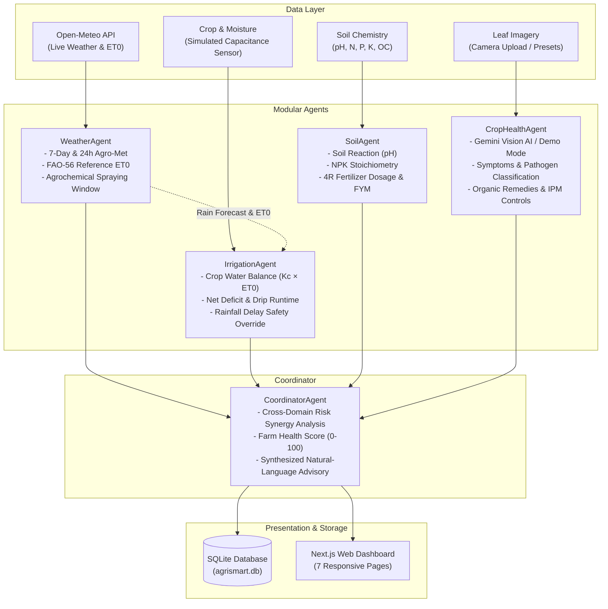

# 🌱 AgriSmart AI – Zero Hunger

> **A Multi-Agent Precision Agriculture System for Smallholder Farmers**  
> Aligned with **United Nations Sustainable Development Goal 2 (Zero Hunger)** to promote climate-resilient crop yields, water conservation, and soil health stewardship.

---

## 🌾 Overview

**AgriSmart AI** combines hyper-local agro-meteorology, FAO-56 crop water balance modeling, soil nutrient stoichiometry (NPK/pH), foliar crop health diagnostics, and multi-agent coordination into a unified, farmer-centric decision dashboard.

### Key Philosophy & Ethical Disclaimers
1. **Advisory Only**: Rules, thresholds, and diagnostic interpretations are illustrative agronomic heuristics based on standard ICAR (Indian Council of Agricultural Research) and MPKV Rahuri guidance. They do **not** replace laboratory soil chemistry tests or certified agricultural extension officer advice.
2. **No Hardware Actuation**: The platform generates calculated schedules and volume advisories, but does **not** automatically trigger physical valves, pumps, or electrical equipment.
3. **Transparent Simulation**: Simulated sensor data is always explicitly labeled with `[SIMULATED SENSOR DATA]` or `[SIMULATED SOIL TEST DATA]` to ensure sensor telemetry is never confused with physical sensor hardware.
4. **100% Free Initial Demo Mode**: No paid services or subscriptions required. Live weather is powered by the free Open-Meteo API. Google Gemini API integration is optional; if no key is provided, the system seamlessly operates in offline Demo Simulation Mode.

---

## 🏗️ Architecture & Modular Agents

AgriSmart AI operates with five modular, specialized agronomic agents orchestrated by a coordinator:



### Modular Agents Description:
1. **`WeatherAgent`**: Interfaces directly with Open-Meteo to fetch live temperature, relative humidity, wind speed, precipitation, and reference evapotranspiration ($ET_0$). Evaluates wind drift and wash-off risks to compute the **Crop Spraying Window** (Optimal, Moderate, Poor).
2. **`IrrigationAgent`**: Implements FAO-56 crop coefficients ($K_c$) for growth stages (Initial, Vegetative, Flowering, Maturity) across major crops. Deducts forecasted effective rainfall ($P_{eff}$) from gross $ET_c$ and calculates net water depth (mm), volume (litres/acre), and drip/sprinkler runtimes.
3. **`SoilAgent`**: Evaluates soil reaction (pH), available Nitrogen, Phosphorus, Potassium, and Organic Carbon against crop target requirements. Generates chemical fertilizer dosages (Urea, SSP/DAP, MOP, Gypsum for alkaline soils, Lime for acidic soils) and organic amendments (FYM, Vermicompost, Neem cake).
4. **`CropHealthAgent`**: Analyzes foliar images via Google Gemini Vision API (if configured) or executes deterministic diagnostic presets in **Demo Simulation Mode** (Soybean Rust, Cotton Leaf Curl, Tomato Early Blight, Sugarcane Red Rot, Healthy Crop).
5. **`CoordinatorAgent`**: Cross-examines outputs across all agents to detect compound agro-climatic risks (e.g. *warm humid weather + fungal vulnerability -> suspend overhead sprinkler irrigation and apply Trichoderma bio-fungicide*) and computes the composite **Farm Health Score** (0–100).

---

## 📱 Web Application Pages

| # | Page | Route | Description |
|---|---|---|---|
| 1 | **Dashboard** | `/` | Executive overview: Farm Health Score (0–100), live weather snapshot, simulated soil moisture, irrigation urgency, 7-day agro-met strip, and coordinated multi-agent advisory. |
| 2 | **Smart Irrigation** | `/irrigation` | Crop selection, phenological growth stage, soil moisture inputs with quick simulated sensor buttons, rain forecast integration, and water volume/runtime recommendations. |
| 3 | **Crop Health** | `/crop-health` | Leaf photo upload, optional Gemini Vision AI, curated demo presets (Soybean Rust, Cotton Leaf Curl, Blight), organic remedies, and IPM chemical controls. |
| 4 | **Soil Analysis** | `/soil-analysis` | pH, N, P, K, moisture, and organic carbon inputs, Maharashtra agro-zone presets (Black Cotton Soil, Red Loam, Alluvial), and 4R fertilizer dosage plans. |
| 5 | **Live Weather** | `/weather` | Real-time Open-Meteo forecasts for Maharashtra districts (Pune, Nashik, Nagpur, Kolhapur, etc.) or custom coordinates, 24h hourly timeline, and chemical spraying window alerts. |
| 6 | **Farmer Chatbot** | `/chat` | **AgriMitra** AI assistant: Gemini-powered when configured, with a comprehensive offline agronomic knowledge base for Marathi/English farming queries. |
| 7 | **History & Logs** | `/history` | SQLite-persisted audit trail of calculations, soil analyses, crop scans, and coordinated advisories. Filterable and exportable as JSON. |

---

## 🛠️ Tech Stack

- **Frontend**: Next.js 14 (App Router), TypeScript, Tailwind CSS, Lucide React Icons
- **Backend**: Python 3.15, FastAPI, Uvicorn, Pydantic v2, SQLAlchemy, HTTPX
- **Database**: SQLite (`agrismart.db`)
- **Weather Engine**: Open-Meteo API (Open, keyless)
- **AI Integration**: Optional Google Gemini API (with deterministic offline fallback)

---

## 🚀 Getting Started

### 1. Prerequisites
- **Python 3.10+** (tested on Python 3.15)
- **Node.js 18+** (Node.js 20 LTS included)

### 2. Environment Configuration (Optional)
Copy `.env.example` to `backend/.env`:
```bash
cp backend/.env.example backend/.env
```
To enable Google Gemini Vision AI and dynamic chatbot responses, insert your free Gemini API key:
```env
GEMINI_API_KEY=your_gemini_api_key_here
```
> **Note**: If left blank, AgriSmart AI runs in **100% Free Offline Demo Simulation Mode** with zero paid service dependencies.

---

### 3. Quick Start (Windows)
Double-click `start.bat` in the project root:
```cmd
start.bat
```
This automatically launches both the FastAPI backend and Next.js frontend in separate terminal windows.

---

### 4. Manual Start

#### Backend:
```bash
cd backend
python -m pip install -r requirements.txt
python -m uvicorn app.main:app --host 127.0.0.1 --port 8000 --reload
```
- API Endpoint: `http://127.0.0.1:8000`
- Interactive Swagger Docs: `http://127.0.0.1:8000/docs`

#### Frontend:
```bash
cd frontend
npm install
npm run dev
```
- Open browser at `http://localhost:3000`

---

## 🧪 Testing

Run backend agent and API test suite:
```bash
# In project root:
set PYTHONPATH=backend
python -m pytest backend/tests -v
```
All 14 unit and integration tests verify:
- Live Open-Meteo weather fetching & fallback
- FAO-56 crop water balance & rain override logic
- Soil reaction & NPK fertilizer dosage stoichiometry
- Crop health demo simulation & disclaimers
- Multi-agent coordination synthesis
- SQLite database persistence

---

## 📜 License & Acknowledgments

- Aligned with **UN SDG 2: Zero Hunger**.
- Agronomic heuristics adapted from **ICAR** and **Mahatma Phule Krishi Vidyapeeth (MPKV), Rahuri, Maharashtra**.
- Weather data provided by **Open-Meteo**.
